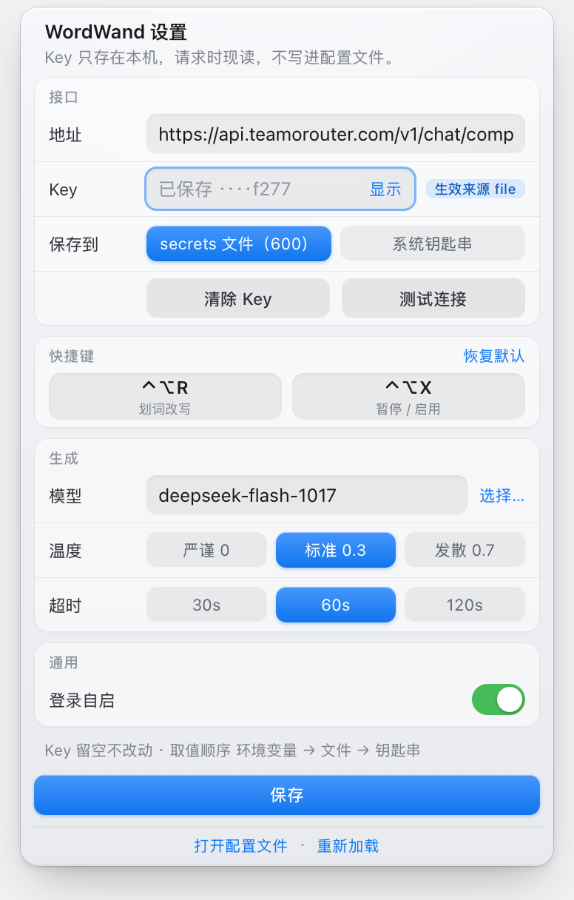
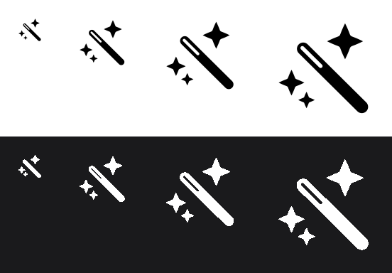

# WordWand

> Select text, hit ⌃⌥R, pick a tone, done — in place.

**A select-to-rewrite tool for macOS, built on [Hammerspoon](https://www.hammerspoon.org/).** It talks to **any OpenAI-compatible endpoint** and collapses "select → copy → call the model → paste back" into two key presses. Your text only goes to the endpoint you configure — never through a third party.

The UI, the shortcuts, the clipboard handling and the panels are all Hammerspoon primitives underneath; this project is a ~1500-line Lua config. **You need Hammerspoon installed** — there is no standalone binary to download.

[](#)
[](https://www.hammerspoon.org/)
[](#license)

[中文](README.md) · **English**


---

## Why

I wanted something like **Myna** — select a sentence, press a key, and it reads better.

Myna *does* have a macOS build, and it's a genuinely nice piece of software. But it's subscription-based: once the free quota runs out you keep paying to use it. I didn't want a recurring bill for a keystroke-level action, and I definitely didn't want to be locked to a single vendor's models — some days I want the cheap one, some days the strong one, and some days I want my own gateway.

So I built my own: **own the UI, own the model.**

- The panel is hand-drawn (not a system component) and follows macOS visual language
- Models are pulled from your endpoint; the key stays in your hands
- Everything lives in one `init.lua` — change behavior by editing it

## What it's built on

WordWand is not a standalone app — it's **a Hammerspoon config**. Knowing that makes install and troubleshooting much easier:

| Capability | Provided by |
|---|---|
| Global shortcuts (⌃⌥R / ⌃⌥X) | `hs.hotkey` |
| Simulate ⌘C / ⌘V for selection and paste-back | `hs.eventtap` + `hs.pasteboard` |
| HTTP + JSON | `hs.http` + `hs.json` |
| Panels (hand-drawn HTML cards) | `hs.webview` |
| Menu bar icon and menu | `hs.menubar` |
| Toasts | `hs.alert` |
| Remembering your model | `hs.settings` |

So: **Hammerspoon must be installed, with Accessibility permission granted**, or the selection can't be read. [Install steps below](#install).

## Features

| | |
|---|---|
| **One shortcut** | No seven-combo memory game. ⌃⌥R opens the panel, ↑↓ picks, ⏎ runs |
| **Seven presets** | Polish / Condense / Formal / ZH→EN / EN→ZH / Casual / Custom |
| **In-place replace** | Result is pasted back over your selection — no window switching, no manual copy/paste |
| **Any model** | Reads `/v1/models` from your gateway; dozens of models, searchable |
| **Remembers** | Recently used models float to the top across restarts; current one is checked |
| **Never steals focus** | The panel is a non-activating overlay, so the original app stays frontmost and paste-back works |
| **Light & dark** | Follows the system appearance; the menu bar icon is a vector template image |
| **Key in the GUI** | Menu bar → Settings…: paste the key, test it, clear it. Stored in a `chmod 600` file or the Keychain — no terminal needed |
| **Real error messages** | HTTP status, parse failures and timeouts surface instead of failing silently |

## Screenshots

**Mode panel** — appears on ⌃⌥R. Arrow keys move, ⏎ runs, digits 1–7 jump straight to an item.


**Model panel** — from the menu bar: *搜索模型…*. Type to filter (no need to click the field first); the active model is checked.


**Settings panel** — menu bar → **设置…**. Everything configurable lives on this one page, split into labelled groups; same glass visual language as the two panels above, and likewise a non-activating overlay that doesn't steal focus from your app.

| Group | Contents |
|---|---|
| 接口 (endpoint) | API endpoint, API key, where to store it (secrets file 600 / Keychain) |
| 快捷键 (shortcuts) | Both hotkeys — click a keycap, then press the new combination |
| 生成 (generation) | Model (「选择…」 opens the model panel), temperature (严谨 0 / 标准 0.3 / 发散 0.7), timeout (30 / 60 / 120 s) |
| 通用 (general) | Launch at login |
| Footer | Open config file, reload |

Keyboard: `Tab` switch field, `⌘A` clear, `⌘V` paste, `⏎` save, `esc` cancel. Only the key and endpoint need Save; everything else is written immediately.



**Menu bar icon** — traced from SF Symbols' `wand.and.stars`: an even-width, round-capped wand held at 45°, with an outlined tip section (a rounded slot carved out of it, as if the head is not lit yet) and three four-point stars — a large one upper right, a medium one at the left, a small one below.



A single 18×18 pt vector template — black plus alpha only — handed to the system as a template image, so macOS inverts it for the light and dark menu bar. There is no second asset to maintain. The geometry lives in `icons/make-icon.py`; rerun it after editing:

```bash
python3 icons/make-icon.py     # overwrites icons/rewrite.pdf
```

`STYLE` at the top of that file selects between three compositions: `"sf"` (the default — a wand plus three stars, traced from `wand.and.stars`), `"star"` (an earlier hand-laid arrangement, with a tapered rod and a beveled tip) and `"rays"` (a ring of short dashes around the tip, after `wand.and.rays`). All three are drawn as plain paths: an SF Symbol cannot be turned into a vector template, because drawing one into a PDF context yields a bitmap that `hs.menubar` crops down to a black blob. The proportions are traced instead — element positions and star-arm weight were measured off the original and converted to points.

## Install

### 1. Hammerspoon

```bash
brew install --cask hammerspoon
```

On first launch it asks for **Accessibility** permission: System Settings → Privacy & Security → Accessibility → enable Hammerspoon. Without it, simulated ⌘C can't read your selection.

### 2. Deploy

```bash
git clone https://github.com/tangbonze/wordwand.git
cd wordwand
./install.sh
```

The script copies `init.lua` and the icon into `~/.hammerspoon/`, backing up any existing `init.lua` as `init.lua.bak.<timestamp>`.

Manual alternative:

```bash
cp init.lua ~/.hammerspoon/init.lua
mkdir -p ~/.hammerspoon/icons && cp icons/rewrite.pdf ~/.hammerspoon/icons/
```

### 3. API key

**Via the GUI (recommended):** click the menu bar icon → **设置…**, paste the key, hit Save — then hit "测试连接" to verify it right there. Takes effect immediately, no reload. The panel also shows which source the current key comes from (env / file / Keychain).

Command line works too; pick one. Lookup order is **env → file → Keychain**.

**A. File (simplest)**

```bash
mkdir -p ~/.hammerspoon/secrets && chmod 700 ~/.hammerspoon/secrets
printf '%s' 'sk-your-key-here' > ~/.hammerspoon/secrets/teamorouter.key
chmod 600 ~/.hammerspoon/secrets/teamorouter.key
```

Takes effect immediately — the file is re-read on every request, no reload needed.

**B. Environment variable**

```bash
launchctl setenv WORDWAND_API_KEY 'sk-your-key-here'
```

`launchctl setenv` does not affect already-running apps; restart Hammerspoon. Note the env var wins over everything: once it's set, a key saved in the GUI is ignored (the panel warns you about this).

**C. Keychain**

```bash
security add-generic-password -s hammerspoon-teamorouter -w 'sk-your-key-here'
```

### 4. Point it at your endpoint (optional)

The default is TeamoRouter. To use OpenAI, DeepSeek, Moonshot, a local vLLM or Ollama, **just change the endpoint in Settings…** — it's remembered (via `hs.settings`) and the model list of the old gateway is invalidated automatically.

Or edit one line at the top of `init.lua`:

```lua
local CFG = {
  api_url = "https://api.openai.com/v1/chat/completions",
  ...
}
```

Anything OpenAI-compatible on `/v1/chat/completions` works. Afterwards refresh the list: menu bar → 模型 → 刷新列表.

### 5. Reload

Menu bar → **设置…** → footer 「重新加载」, or ⌘R in the Hammerspoon console.

You should see:

```
WordWand 已就绪 · 模型 deepseek-v4-flash（列表 53 个）· ⌃⌥R 弹面板 · API Key 已配置(file)
```

## Usage

| Action | Shortcut |
|---|---|
| Open panel on selection | `⌃⌥R` |
| Move | `↑` `↓` |
| Run | `⏎` |
| Jump to item N | `1`–`7` |
| Cancel | `esc` |
| Pause / resume all shortcuts | `⌃⌥X` |

Typical flow:

1. Select text in any app (Mail, Slack, Notes, browser — anything)
2. Press `⌃⌥R`
3. Pick a mode with `↑↓`, press `⏎`
4. A "润色中…" toast appears, then the selection is replaced and you get a "润色完成" confirmation

The menu bar menu now only holds actions: run a mode directly, switch model (search / refresh / custom live in that submenu), and a single **设置…**. Everything that is configuration moved into the settings page — connection test, clear key, open config and reload live there too, and pausing is just the `⌃⌥X` hotkey.

## Customizing

### Add a mode

Append to the `MODES` table. The panel grows automatically (window height is computed from the item count):

```lua
{ name = "译成日文", hint = "自然日语，敬语得体",
  prompt = "把下面的文字翻译成自然的日语，敬语得体，不要翻译腔。只输出译文。" },
```

### Change the default model

Pick one from the menu once — it's persisted via `hs.settings`. Or edit `CFG.models[1]`.

### Change the shortcut

Menu bar → **设置…** → the 快捷键 group: click a keycap, then press the combination you want. At least one of `⌃ ⌥ ⇧ ⌘` is required; `esc` cancels. The two hotkeys can't collide — it tells you and leaves the binding untouched. Changes apply immediately and persist in `hs.settings` (`hotkey:pick` / `hotkey:toggle`), so a reload or reinstall keeps them.

From the console:

```lua
hsRewriteHotkeySet("pick", {"ctrl", "alt"}, "E")   -- rewrite hotkey becomes ⌃⌥E
hsRewriteResetHotkeys()                            -- back to ⌃⌥R / ⌃⌥X
```

## FAQ

**Nothing happens**
Check Hammerspoon's Accessibility permission, then open the console (menu bar → Console) for Lua errors.

**"先选中一段文字再按 ⌃⌥R"**
Selection is read by simulating `⌘C`. Apps that don't support `⌘C` (some terminals, remote desktops, games) won't work.

**HTTP 401 / 403**
Wrong or missing key. Open menu bar → **设置…**, paste a key and hit "测试连接" — it tells you which step failed (no key / key rejected / network down), and the status pill shows the source currently in effect (env / file / keychain).

**Model not found / 400**
Try another model. Not every model listed by `/v1/models` is callable; image models (name contains `image`) are filtered out automatically since they can't serve chat completions.

**My clipboard changed**
The clipboard is used to carry the result, then restored after 0.9 s. Non-text clipboard contents may not survive intact.

**Empty model list / odd panel**
Delete `~/.hammerspoon/models.cache.json` and reload to re-fetch.

## Project layout

```
wordwand/
├── init.lua                 # all logic, single file, ~1500 lines
├── icons/rewrite.pdf        # menu bar icon (18×18 vector template)
├── icons/make-icon.py       # icon generator, rerun after tweaking geometry
├── install.sh               # deploy to ~/.hammerspoon
├── docs/screenshots/        # documentation images
├── README.md                # 中文
└── README.en.md             # English
```

Sections inside `init.lua`:

- `CFG` — configuration (endpoint, key sources, fallback models)
- `MODES` — the seven prompts
- `request()` — request building, timeout guard, error classification
- `readSelection()` / `pasteText()` — grab the selection, paste it back
- `POP` / `MPICK` / `SET` — the three hand-drawn screens (mode picker, model picker, settings)

## Known limitations

- **macOS only**, depends on Hammerspoon
- Selection capture relies on simulated `⌘C`; a few apps won't cooperate
- Long text is bounded by the model's context window — it errors instead of chunking
- The panel is fixed at horizontal center, ~26% down the screen; it doesn't follow the cursor

## How it differs from Myna

| | Myna | WordWand |
|---|---|---|
| Platform | macOS / Windows | macOS |
| Form | Standalone app | Hammerspoon config |
| Models | Vendor cloud, fixed | Any OpenAI-compatible endpoint |
| Pricing | Subscription / free quota | **Free** — you only pay your own API usage |
| Data | Sent to vendor's cloud AI | Only to the endpoint you configure |
| Customization | Custom prompts | Edit the code — anything is fair game |

## Credits

- [Hammerspoon](https://www.hammerspoon.org/) — every primitive here is theirs
- Myna — the interaction inspiration. It nailed "select and rewrite in place"; this project just takes a different route: **your models, your pricing**

## License

[MIT](LICENSE) © 2026 Ke Feng
