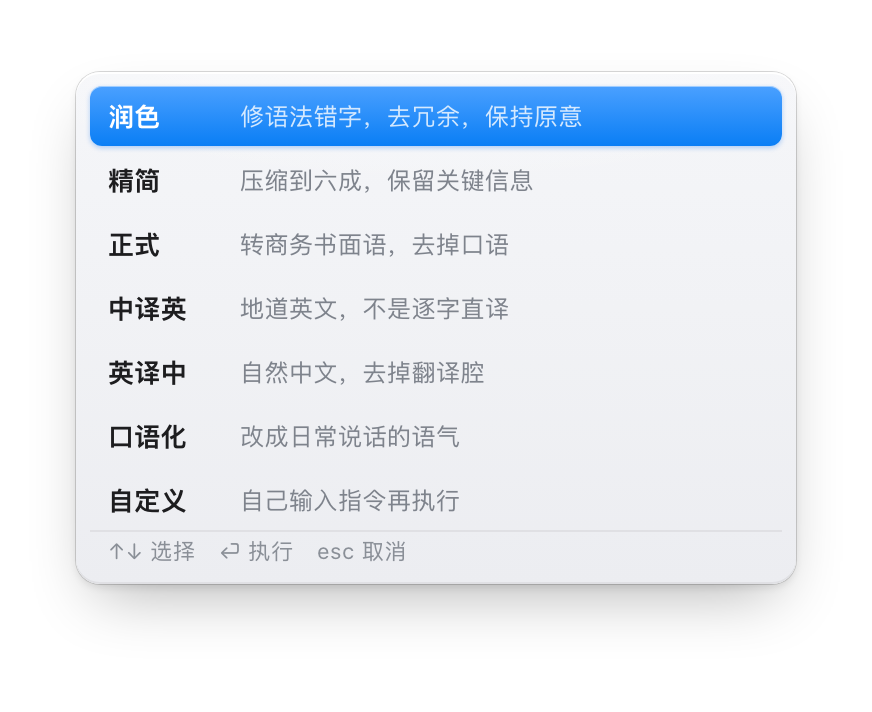
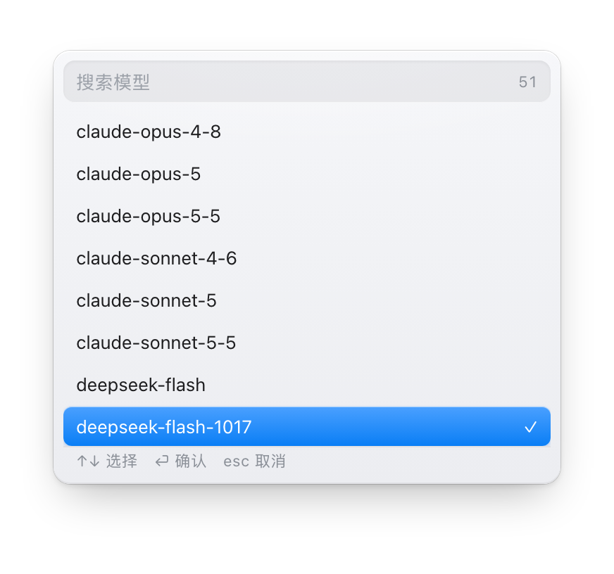

# WordWand · 文字魔杖

> 选中一段文字，按一下 ⌃⌥R，选个语气，原地改好。

**一个基于 [Hammerspoon](https://www.hammerspoon.org/) 的 macOS 划词改写工具。** 它接**任意 OpenAI 兼容接口**，把「选中 → 复制 → 调模型 → 粘回原位」压缩成两次按键。文字只进你自己配置的接口，不经过任何第三方服务器。

界面、快捷键、剪贴板、面板渲染全部由 Hammerspoon 提供底层能力，本项目是一份 ~1000 行的 Lua 配置——**装上 Hammerspoon 才能跑**，没有独立 App 可执行文件。

[](#)
[](https://www.hammerspoon.org/)
[](#license)

**中文** · [English](README.en.md)



---

## 为什么要做这个

起因是想找一个像 **Myna 鸣意** 那样的划词改写工具：选中一句话，按一下，它就变通顺了。

Myna 是有 macOS 版的，体验也确实不错——但它是订阅制，免费额度用完之后要持续付费才能继续用。我不想为了「按一下改写」这种高频小动作按月交钱，更不想被锁死在某一家模型上：今天想用便宜的、明天想换更强的、或者想让文字走自己的网关，都应该由我说了算。

所以干脆自己搭一个：**界面自己做，模型自己接**。

- 面板是自绘的（不是系统组件），样式跟着 macOS 走
- 模型从你自己填的接口地址拉，Key 也由你自己保管
- 全部逻辑在一个 `init.lua` 里，想改行为直接改代码

## 它建立在什么之上

WordWand 不是一个独立应用，它是 **Hammerspoon 的一份配置**。理解这一点，安装和排错都会简单很多：

| 你需要的能力 | 由谁提供 |
|---|---|
| 全局快捷键（⌃⌥R / ⌃⌥X） | `hs.hotkey` |
| 模拟 ⌘C/⌘V 取选区、粘回 | `hs.eventtap` + `hs.pasteboard` |
| 调 HTTP 接口、解析 JSON | `hs.http` + `hs.json` |
| 面板渲染与交互 | `hs.webview`（自绘 HTML 卡片） |
| 菜单栏图标与菜单 | `hs.menubar` |
| 提示气泡 | `hs.alert` |
| 记住选过的模型 | `hs.settings` |

因此：**Hammerspoon 必须先装好并授予辅助功能权限**，否则取不到选区。[安装步骤见下](#安装)。

## 功能

| 功能 | 说明 |
|---|---|
| **一个快捷键** | 不用记七个组合键。⌃⌥R 弹面板，↑↓ 选，⏎ 执行 |
| **七种预设** | 润色 / 精简 / 正式 / 中译英 / 英译中 / 口语化 / 自定义 |
| **原位替换** | 处理完自动粘回你选中的位置，不跳窗口、不用手动复制粘贴 |
| **模型随便换** | 自动读取网关 `/v1/models`，几十个模型可搜索切换 |
| **记住选择** | 最近用过的模型排在最前，重启不丢；当前模型打勾 |
| **不抢焦点** | 面板是非激活浮层，弹出来时原来的 App 仍是前台，粘贴才回得去 |
| **按系统规范长** | 面板照 macOS 27 Golden Gate 的 Liquid Glass 重绘：统一收紧的圆角、压暗的玻璃边缘配镜面高光、列表滚动到栏下时边缘渐隐 |
| **明暗自适应** | 跟随系统外观切换深浅色；菜单栏图标是矢量模板图，自动反色 |
| **Key 不写进配置** | 环境变量 / `chmod 600` 文件 / 系统钥匙串，三种取法按顺序尝试 |
| **出错有话说** | HTTP 状态、解析失败、超时都会明确提示，不静默失败 |

## 界面

**模式面板** —— 选中文字后按 ⌃⌥R 出现，↑↓ 移动，⏎ 执行，数字键 1–7 直接选。


**模型面板** —— 菜单栏里点「搜索模型…」打开。顶部是搜索框，直接打字就过滤（不用先点输入框），当前模型带 ✓。



## 安装

### 1. 安装 Hammerspoon

```bash
brew install --cask hammerspoon
```

首次启动会要求**辅助功能**权限：系统设置 → 隐私与安全性 → 辅助功能 → 勾选 Hammerspoon。没有这个权限，模拟 ⌘C 拿不到选区。

### 2. 部署配置

```bash
git clone https://github.com/tangbonze/wordwand.git
cd wordwand
./install.sh
```

脚本会把 `init.lua` 和图标复制到 `~/.hammerspoon/`，原有的 `init.lua` 会先备份成 `init.lua.bak.<时间戳>`。

不想用脚本就手动两步：

```bash
cp init.lua ~/.hammerspoon/init.lua
mkdir -p ~/.hammerspoon/icons && cp icons/rewrite.pdf ~/.hammerspoon/icons/
```

### 3. 配置 API Key

三种方式任选一种，程序按 **环境变量 → 文件 → 钥匙串** 的顺序查找。

**A. 文件（最省事）**

```bash
mkdir -p ~/.hammerspoon/secrets && chmod 700 ~/.hammerspoon/secrets
printf '%s' 'sk-your-key-here' > ~/.hammerspoon/secrets/teamorouter.key
chmod 600 ~/.hammerspoon/secrets/teamorouter.key
```

改完立刻生效，**不需要重载**（每次请求都重新读文件）。

**B. 环境变量**

```bash
launchctl setenv WORDWAND_API_KEY 'sk-your-key-here'
```

注意：`launchctl setenv` 对已经运行的 App 不生效，需要重开 Hammerspoon。

**C. 系统钥匙串**

```bash
security add-generic-password -s hammerspoon-teamorouter -w 'sk-your-key-here'
```

### 4. 换成你自己的接口（可选）

默认指向 TeamoRouter。想换 OpenAI、DeepSeek、Moonshot、本地 vLLM / Ollama 都行，改 `init.lua` 顶部一处：

```lua
local CFG = {
  api_url = "https://api.openai.com/v1/chat/completions",
  ...
}
```

只要是 OpenAI 兼容的 `/v1/chat/completions` 就能用。换完之后把模型列表也刷一下（菜单栏 → 模型 → 刷新列表）。

### 5. 重载

菜单栏图标 → **重新加载配置**，或直接在 Hammerspoon 控制台按 ⌘R。

控制台出现下面这行就成功了：

```
WordWand 已就绪 · 模型 deepseek-v4-flash（列表 53 个）· ⌃⌥R 弹面板 · API Key 已配置(file)
```

## 使用

| 操作 | 快捷键 |
|---|---|
| 选中文字后打开面板 | `⌃⌥R` |
| 面板内上下移动 | `↑` `↓` |
| 执行 | `⏎` |
| 直接选第 N 项 | `1`–`7` |
| 取消 | `esc` |
| 暂停 / 恢复全部快捷键 | `⌃⌥X` |

典型流程：

1. 在任意 App 里选中一段文字（邮件、微信、备忘录、浏览器都行）
2. 按 `⌃⌥R`
3. 屏幕中央弹出面板，`↑↓` 选模式，`⏎`
4. 中央出现「润色中…」，完成后自动替换，并提示「润色完成」

菜单栏图标点开还有：直接执行某个模式、切换模型、搜索模型、测试 API 连接、打开配置文件、重新加载、暂停快捷键。

## 自定义

### 加一种处理方式

改 `init.lua` 里的 `MODES`，加一项即可，面板会自动多一行（窗口高度是按条目数算的，不用手调）：

```lua
{ name = "译成日文", hint = "自然日语，敬语得体",
  prompt = "把下面的文字翻译成自然的日语，敬语得体，不要翻译腔。只输出译文。" },
```

### 改默认模型

菜单里选一次就记住了（存 `hs.settings`）。也可以直接改 `CFG.models[1]`。

### 改快捷键

```lua
local hkPick = hs.hotkey.bind({ "ctrl", "alt" }, "R", pick)
```

`"R"` 换成你想用的键即可，比如 `"E"`。

## 常见问题

**按了没反应**
先确认 Hammerspoon 有「辅助功能」权限；再打开控制台（菜单栏图标 → Console）看有没有 Lua 报错。

**提示「先选中一段文字再按 ⌃⌥R」**
工具是靠模拟 `⌘C` 读选区的。目标 App 如果不支持 `⌘C`（部分终端、远程桌面、游戏），就读不到内容。

**提示 HTTP 401 / 403**
Key 不对或没配。点菜单里的「API Key：…」会显示当前是从哪个来源读到的（env / file / keychain）。

**提示模型不存在 / 400**
换一个模型试试。网关 `/v1/models` 里列出的模型不一定全部开放调用；图像类模型（名字含 `image`）也被自动过滤掉了，因为它们走不了 chat 接口。

**剪贴板被改了**
为了保证「粘回原位」，处理期间会临时占用剪贴板，0.9 秒后还原成你原来的内容。如果原来剪贴板里是图片或文件，可能无法完整还原。

**面板看起来不对 / 模型列表是空的**
删掉 `~/.hammerspoon/models.cache.json` 再重载，会重新拉一次列表。

## 项目结构

```
wordwand/
├── init.lua                 # 全部逻辑，单文件，约 1000 行
├── icons/rewrite.pdf        # 菜单栏图标（18×18 矢量模板图）
├── install.sh               # 一键部署到 ~/.hammerspoon
├── docs/screenshots/        # 文档截图
├── README.md                # 中文
└── README.en.md             # English
```

代码分几块，看 `init.lua` 里的注释标题就行：

- `CFG` —— 配置区（接口地址、Key 来源、兜底模型）
- `MODES` —— 七种处理方式的提示词
- `request()` —— 组装请求、超时保护、错误归类
- `readSelection()` / `pasteText()` —— 取选区、粘回原位
- `POP` / `MPICK` —— 两个自绘面板（模式选择、模型选择）

## 已知限制

- **仅 macOS**，依赖 Hammerspoon
- 取选区依赖模拟 `⌘C`，对少数 App 无效
- 长文本受模型上下文长度限制，超出会报错而不是自动切分
- 面板位置固定在屏幕水平居中、垂直约 26% 处，不跟随光标

## 和 Myna 的区别

| | Myna 鸣意 | WordWand |
|---|---|---|
| 平台 | macOS / Windows | macOS |
| 形态 | 独立 App | Hammerspoon 配置 |
| 模型 | 官方云端，不可更换 | 任意 OpenAI 兼容接口 |
| 计费 | 订阅 / 免费额度 | **免费**，只付你自己的 API 费用 |
| 数据 | 发送至官方云端 AI | 只发到你配置的接口 |
| 定制 | 自定义提示词 | 改代码，任何行为都能改 |

## 致谢

- [Hammerspoon](https://www.hammerspoon.org/) —— 本项目的全部底层能力都来自它
- Myna 鸣意 —— 交互上的灵感来源。它把「选中即改写」这件事做得很顺手，而这个项目只是换了一条路：**用你自己的模型、按你自己的价格**

## License

[MIT](LICENSE) © 2026 Ke Feng
